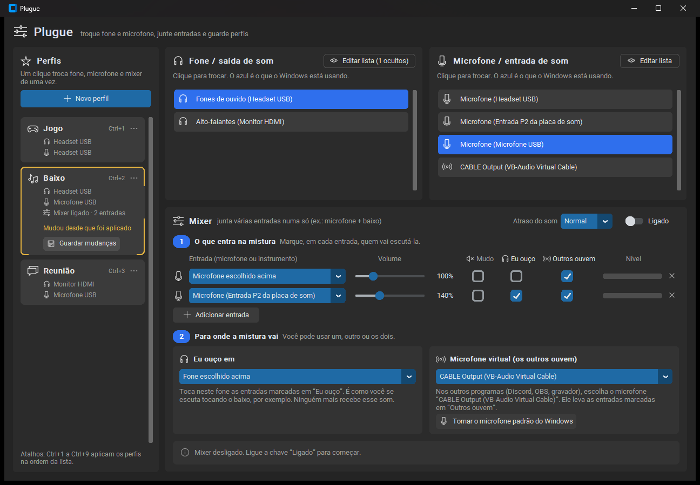
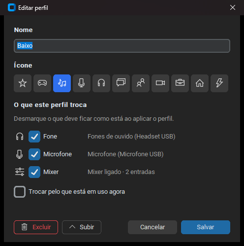

# Plugue

**Plugue** é um aplicativo para Windows que troca o fone e o microfone com um clique, junta várias entradas de som numa só (por exemplo, a sua voz e um instrumento ligado na entrada P2) e guarda tudo isso em perfis.



## O que ele faz

- **Fone e microfone independentes.** Duas listas: clique num fone e num microfone quaisquer, e eles viram o padrão do Windows. Dá para usar o fone de um headset com o microfone de outro.
- **Mixer.** Junta até 4 entradas. Em cada uma você escolhe o volume (até 400%) e quem escuta:
  - **Eu ouço**: toca no seu fone, para você se escutar (por exemplo, enquanto toca baixo).
  - **Outros ouvem**: vai para um **microfone virtual**, que Discord, OBS e outros programas usam como se fosse um microfone de verdade.
- **Perfis.** Guarde combinações como "Jogo", "Baixo" ou "Reunião". Cada perfil pode trocar o fone, o microfone, o mixer ou só parte disso. Aplique com um clique ou com **Ctrl+1** a **Ctrl+9**. Quando algo muda depois de aplicar um perfil, o cartão avisa e oferece guardar as mudanças.
- **Proteções.** O app não manda o microfone virtual de volta para ele mesmo (o que causaria microfonia), avisa quando nenhuma entrada vai chegar ao destino e continua funcionando quando um dispositivo é desconectado.



## Microfone virtual

O Windows só cria microfones virtuais por meio de um driver. O app funciona com o **[VB-CABLE](https://vb-audio.com/Cable/)**, da VB-Audio (donationware):

1. Baixe o `VBCABLE_Driver_Pack` no site oficial e extraia o .zip.
2. Execute o instalador de 64 bits como administrador e clique em "Install Driver".
3. Reinicie o computador.

Depois disso, "CABLE Output" aparece no cartão "Microfone virtual" do app. Outros cabos da VB-Audio (Hi-Fi Cable, VB-CABLE A+B e C+D) também são reconhecidos.

## Como usar

Baixe o `Plugue.exe` na página de [Releases](../../releases) e abra. Não precisa instalar nada.

A configuração fica em `%APPDATA%\Plugue\config.json`.

## Rodar a partir do código

Requer Windows 10 ou 11 e Python 3.11 ou mais novo.

```bat
python -m venv .venv
.venv\Scripts\pip install -r requirements.txt
.venv\Scripts\python app.py
```

Testes (não abrem dispositivos de som nem janelas):

```bat
.venv\Scripts\python -m unittest discover -s tests -v
```

Para gerar o `.exe`, rode `construir.bat`. O arquivo sai em `dist\Plugue.exe`.

## Organização do código

| Arquivo | Função |
| --- | --- |
| `app.py` | Janela principal: listas de dispositivos, mixer e barra de perfis |
| `perfis.py` | Cartões de perfil e janela de edição |
| `mixer.py` | Motor de áudio: capta as entradas, mistura e envia para as saídas |
| `dispositivos.py` | Lista os dispositivos do Windows e troca o padrão |
| `config.py` | Leitura e gravação da configuração |
| `icones.py`, `tema.py` | Ícones (da fonte Segoe MDL2, que vem no Windows) e cores |

### Como o mixer funciona

Cada dispositivo de som tem o próprio relógio, então uma entrada sempre produz um pouco mais ou um pouco menos de amostras do que a saída consome. Entre cada entrada e cada saída há um buffer circular (`Anel`) que reamostra o áudio bem de leve (no máximo 0,3%, o que não se ouve) para manter o buffer sempre no mesmo nível. Assim o som não acumula atraso nem dá cortes.

A opção "Atraso do som" define a folga desse buffer: 15, 30 ou 60 ms. Num PC de teste, o tempo entre a entrada do mixer e o microfone virtual do VB-CABLE foi de cerca de 145 ms no "Normal", somando o buffer do próprio driver. O ajuste "Baixo" teve cerca de um corte por minuto nesse PC, e o "Normal" não teve nenhum.

## Limitações

- Só Windows (usa WASAPI e a API de dispositivos padrão do Windows).
- O mixer só funciona com o app aberto.
- Com o "Atraso do som" em "Normal", você ouve o próprio instrumento com um pequeno atraso no fone.

## Licença

[MIT](LICENSE). O VB-CABLE é um produto separado da VB-Audio, com licença própria.
